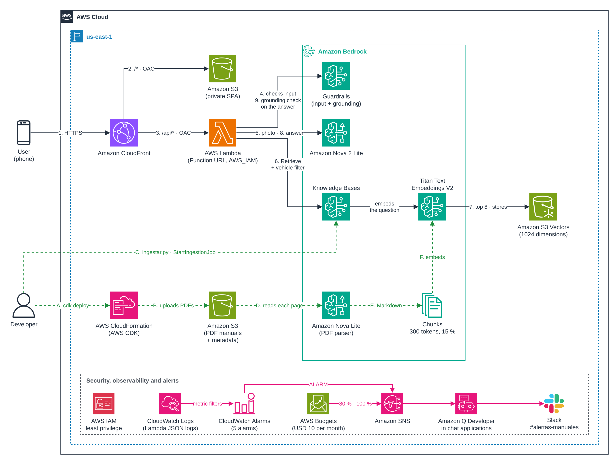
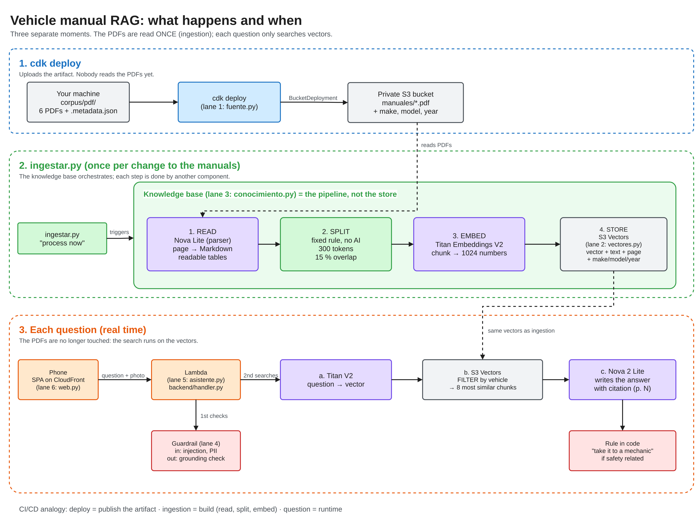

# vehicle-manual-rag

**An assistant that answers from the owner's manual of YOUR motorcycle or car, citing the page.**
Ask "how often do I change the oil?" or upload a photo of the dashboard ("what does this light mean?") and it answers from that vehicle's manual. If the topic is safety related, it tells you to take the vehicle to a mechanic.


-blue)



> Solid line: each question. Dotted line: manual ingestion. Pink: alerts.
> Editable diagram: [`docs/arquitectura.drawio`](docs/arquitectura.drawio) (draw.io). The step-by-step flow is in [How it works](#how-it-works). To regenerate the PNGs, see [`docs/README.md`](docs/README.md).

> **Versión en español.** La app responde en español y está pensada para personas en Colombia; por eso la interfaz, los prompts, el set de pruebas y los comentarios del código están en español. La documentación está en inglés. La última versión de este README en español está en el [historial del repositorio](https://github.com/cr-montoya/vehicle-manual-rag/blob/2fa7006/README.md).

**About the language.** The app's end users are Spanish speakers in Colombia, so the web UI, the prompts, the golden test set and the code comments are in Spanish on purpose. Identifiers (Python modules, CDK construct IDs) are kept as they are because renaming construct IDs would replace deployed AWS resources. A short glossary: *manual* = manual, *carril* = lane (one CDK construct per file), *set dorado* = golden set, *bitácora* = engineering log, *pruebas* = tests.

---

## Contents

1. [What problem it solves](#what-problem-it-solves)
2. [How it works](#how-it-works)
3. [Architecture decisions](#architecture-decisions)
4. [Security and governance controls](#security-and-governance-controls)
5. [Lessons learned](#lessons-learned)
6. [Repository layout](#repository-layout)
7. [Deploy](#deploy)
8. [Tests](#tests)
9. [Costs](#costs)
10. [Tear down](#tear-down)
11. [Manuals and copyright](#manuals-and-copyright)
12. [License](#license)

---

## What problem it solves

Owner's manuals have hundreds of pages and nobody reads them. The information is there, but you cannot find it when you need it.

The main risk is not that the assistant does not know: it is that it **answers from the wrong manual** (the oil interval of a different motorcycle) or that it **makes up a citation**. The whole design revolves around preventing those two things.

**Autonomy level: 2 (RAG).** No agent is needed: there are no actions and no path that depends on the case. An agent with tools was ruled out because it adds latency and risk without adding value here.

**Corpus:** 6 official manuals, 4 motorcycles and 2 cars, in Spanish and English.

| Vehicle | Type | Manual language |
| --- | --- | --- |
| Honda Wave 110i (2015) | Motorcycle | Spanish |
| Yamaha XTZ125 | Motorcycle | Spanish |
| Yamaha XTZ250 | Motorcycle | Spanish |
| Bajaj Pulsar NS125 | Motorcycle | English |
| Nissan Frontier (2023) | Pickup truck | Spanish |
| BYD Seagull (electric) | Car | English |

Questions about the English manuals are answered in Spanish, keeping the page citation.

---

## How it works

There are three separate moments. The PDFs are read **only once**, during ingestion; each question only searches the vectors.



### Each question (real time)

| Step | What happens | Service |
| --- | --- | --- |
| 1 | The user opens the web app on their phone over HTTPS | Amazon CloudFront |
| 2 | CloudFront serves the SPA from a private bucket (`/*`, Origin Access Control) | Amazon S3 |
| 3 | The SPA sends the question, vehicle and photo to `/api/*`. CloudFront signs the request to the Lambda function (OAC) | AWS Lambda (Function URL with `AWS_IAM`) |
| 4 | The guardrail checks the input: prompt injection, insults and personal data | Amazon Bedrock Guardrails |
| 5 | If there is a photo, Nova describes the dashboard warning light; that description is added to the search | Amazon Nova 2 Lite |
| 6 | The knowledge base searches **only the manual of the selected vehicle** (filter on make, model and year) | Amazon Bedrock Knowledge Bases |
| 7 | Titan embeds the question and S3 Vectors returns the 8 most similar chunks | Amazon Titan Text Embeddings V2, Amazon S3 Vectors |
| 8 | Nova writes the answer with the page cited | Amazon Nova 2 Lite |
| 9 | The guardrail compares the answer with the chunks (contextual grounding). If it states something that is not there, the answer is not delivered and the pages are shown for review. If the question describes a safety symptom, the code adds "take it to a mechanic" | Amazon Bedrock Guardrails |

The code for these steps is in [`backend/handler.py`](backend/handler.py), commented step by step.

### Ingestion (once per change to the manuals)

| Step | What happens | Who does it |
| --- | --- | --- |
| A | `cdk deploy` uploads the PDFs and their metadata (`.metadata.json`) to S3 | AWS CDK |
| B | `ingestar.py` tells the knowledge base "process now" | Script |
| C | **Read:** each page is read as an image and transcribed to Markdown, with readable tables | Amazon Nova Lite (parser) |
| D | **Split:** the text is cut into 300-token chunks with 15 % overlap. It is a fixed rule, no AI | Knowledge base |
| E | **Embed:** each chunk becomes a vector of 1024 numbers | Titan Text Embeddings V2 |
| F | **Store:** the vector is stored with its text, its page and the vehicle metadata | S3 Vectors |

> The knowledge base **is not a store**: it is the pipeline that orchestrates. Nova and Titan are the workers; S3 Vectors is the store.
> CI/CD analogy: `cdk deploy` publishes the artifact, ingestion is the build and each question is the runtime.

The whole ingestion recipe (where to read from, how to parse, how to split, which model embeds) is **versioned configuration** in [`infra/infra_manuales/conocimiento.py`](infra/infra_manuales/conocimiento.py), not a loose script.

### Alerts

Five CloudWatch alarms and an AWS Budgets budget publish to an SNS topic. **Amazon Q Developer in chat applications** (formerly AWS Chatbot) delivers it to a Slack channel. No webhook and no secret to store.

| Alert | Signal | Threshold | What to do when it fires |
| --- | --- | --- | --- |
| Errors | Lambda errors | 1 or more in 5 min | Check the logs to see which step failed |
| Latency | p90 duration | Over 20 s in 15 min | Check whether it is Bedrock or the search |
| Abuse | Invocations | Over 200 per hour | Put AWS WAF with a rate limit on CloudFront |
| **Attacks** | Guardrail blocks (log metric filter) | 5 or more in 15 min | Check the source: it is evidence that the control works |
| **Quality** | % of "not found" answers (log metric filter) | Over 40 % in 1 h | Run the golden set: possible parsing regression |
| Cost | AWS Budgets | 80 % actual or 100 % forecasted of USD 10 per month | Tear down the stack or investigate the spend |

The **attacks** and **quality** alerts are specific to an AI system: a RAG can be 100 % available and still answer badly.

---

## Architecture decisions

Criteria, in order of weight: (1) never answer from the wrong manual, (2) traceable answer with a citation, (3) usable from a phone by a non-technical person and (4) near-zero cost and easy to destroy.

| Decision | Chosen | Ruled out | Why |
| --- | --- | --- | --- |
| RAG | Amazon Bedrock Knowledge Bases | Custom pipeline (LangChain) | Less code and operations; the pipeline becomes configuration |
| Vector store | **Amazon S3 Vectors** | Amazon OpenSearch Serverless | OpenSearch Serverless bills compute in OCU-hours (USD 0.24 per OCU-hour in us-east-1, about USD 175 per month for each OCU kept running), and any [minimum capacity](https://docs.aws.amazon.com/opensearch-service/latest/developerguide/serverless-scaling.html) above 0 is billed even when idle. S3 Vectors bills only storage, writes and queries |
| Parser | **Nova Lite (vision model)** | Default parser (text only) | The default parser loses the columns of the maintenance tables. Cost: tokens per page, only at ingestion |
| Generator | **Nova 2 Lite** | Claude; Nova Pro | Reads images, is cheap and is covered by AWS credits. Nova Pro was tried against the golden set: it did not improve and it attributed a chain lubrication value to the engine oil, so it was reverted |
| Vehicle filter | Metadata on each chunk, filter before searching | One index per vehicle | A single index scales; the filter guarantees no other manual gets in |
| Entry point | **CloudFront in front of everything** | Public Function URL | One domain, no CORS, the Lambda function cannot be reached without going through the edge, and that is where WAF goes |
| Alerts | Slack through Amazon Q Developer | Webhook + Lambda + Parameter Store | Equally free, no code or secret to look after |
| Infrastructure | AWS CDK in Python, one file per lane | A single monolithic stack | Each lane can be read and explained on its own |

---

## Security and governance controls

All controls live **outside the model**: they hold even if the model is wrong or manipulated.

| Control | Where it lives | What it prevents |
| --- | --- | --- |
| Vehicle filter before searching | `handler.py`, `buscar()` | Answering from another vehicle's manual |
| No identified vehicle, ask first | `handler.py`, step 1 | Guessing the vehicle |
| Guardrail on input and output, pinned version | `guardrail.py` | Prompt injection, insults, personal data in clear text |
| Contextual grounding on every answer | `guardrail.py`, `handler.py` step 6 | Answers with a real citation but a value that is not in the chunk |
| No chunks, no model call | `handler.py`, step 5 | Answers without a source |
| "Not found" is returned on its own, no filler | `handler.py` | The model filling in with its own knowledge |
| Safety rule in code, based on symptoms (red lights, brakes, temperature, leaks, noises) | `handler.py`, `TEMAS_SEGURIDAD` | "Take it to a mechanic" depending on the model, or showing up on every question until nobody reads it |
| Least-privilege IAM per lane | Each file in `infra_manuales/` | A component being able to do more than it needs |
| Private buckets, SSE-S3, HTTPS only | `fuente.py`, `web.py` | Direct access to the data |
| Lambda only invocable by CloudFront (OAC, `AWS_IAM`) | `web.py` | Bypassing the edge |
| JSON logs per step, one-week retention | `handler.py`, `asistente.py` | Not knowing which step failed or why |

---

## Lessons learned

The five most important ones. The full list of problems that came up, with symptom, cause, fix and lesson, is in the **[engineering log](docs/bitacora.md)**, including the diagnosis mistakes.

### 1. Parsing is the most underestimated decision in a RAG

The first version used the default parser, which only extracts text. In the Yamaha XTZ125 maintenance chart, the *Engine oil* row marks the kilometers with check marks in columns. The parser produced `Aceite de motor / Cambiar / √√√√√√` ("Engine oil / Change / √√√√√√"): the columns were lost and **no chunking or embedding could recover them**. The assistant answered, correctly, that it could not find it.

**Fix:** a vision model as the parser, which reads the page as an image.

### 2. Hallucinations also happen at ingestion

The first parser prompt included a concrete example ("Engine oil: change at 500 km, 3000 km..."). On the **alphabetical index** page, Nova Lite copied the example and **invented an oil table** that does not exist. That fake chunk was the top result for "how often do I change the oil?": the assistant would have cited "(p. 89)" with full confidence, and that page is the index.

It was caught by **checking the citation against the source PDF**. Fix: a prompt with no content examples that forbids inventing, and a full re-ingestion with a new data source (the old one is deleted along with its vectors).

**Consequence for testing:** the golden set checks the **cited page**, not just that the answer sounds right.

### 3. Grounding is not the same as completeness

With the parser fixed, **contextual grounding** was added to the guardrail: each answer is compared with the chunks and, if it states something that is not there, it is not delivered. The real scores:

| Question | Grounding | Result |
| --- | --- | --- |
| Red oil pressure light (Nissan Frontier) | 0.99 | Delivered |
| Oil capacity (Yamaha XTZ125) | 0.87 | Delivered: 1.00 L, p. 50 |
| How often do I change the oil (Yamaha XTZ125) | 0.92 | Delivered: "every 3000 km (p. 44)" |
| Trap: motorcycle question with the pickup truck selected | **0.49** | **Blocked**: the pages are shown for review |

The oil case shows the limit of the control: the maintenance chart marks a change at **500**, 3000, 6000, 9000, 12000 and 15000 km. "Every 3000 km" **is supported**, but it **leaves out the first change at 500 km**. Grounding measures that what is said is in the source, not that it is complete.

**Consequence:** the golden set checks the expected values of each answer (for example "500 km" and "3000 km"), not just that there is a citation.

### 4. A warning that always shows up stops being useful

The "take it to a mechanic" rule fired on the word *oil*, even for "how much oil does it take?". Now it fires on **symptoms** in the question or the photo (red lights, brakes, temperature, leaks, noises), not on the model's answer.

### 5. The backend must not be reachable without going through the edge

The first version exposed the Lambda Function URL publicly. Now CloudFront is the only door: the Lambda function requires a signature (`AWS_IAM`) and only CloudFront signs (OAC). For `POST` requests, the browser sends the SHA-256 of the body in the `x-amz-content-sha256` header, as Lambda requires.

---

## Repository layout

```
.
├── backend/handler.py            Lambda: the steps of each question, commented
├── web/index.html                Mobile SPA (vehicle, question, photo)
├── corpus/manuales.json          Catalog: vehicle, metadata and official PDF URL
├── pruebas/                      Tests
│   ├── set_dorado.json           Golden set: 10 questions with the answer verified in the PDF
│   ├── evaluar.py                Runs the golden set against the Lambda function
│   └── resultados.md             Latest report (generated, in Spanish)
├── scripts/
│   ├── descargar_manuales.py     Downloads the PDFs and writes their metadata
│   └── ingestar.py               Starts the ingestion job and waits for it to finish
├── infra/                        AWS CDK in Python (uv)
│   ├── app.py
│   └── infra_manuales/
│       ├── stack.py              Index: wires the seven lanes together
│       ├── fuente.py             1. S3 with the PDFs
│       ├── vectores.py           2. S3 Vectors
│       ├── conocimiento.py       3. Knowledge base: parser, chunking, embeddings
│       ├── guardrail.py          4. Bedrock Guardrails
│       ├── asistente.py          5. Lambda function and its permissions
│       ├── web.py                6. CloudFront, SPA and Function URL with OAC
│       └── alertas.py            7. Alarms, budget and Slack
└── docs/
    ├── 00-inception.md           Inception (AI-DLC): intent, criteria, assumptions
    ├── bitacora.md               Engineering log: problems found and how they were solved
    ├── arquitectura.drawio       Editable architecture diagram
    ├── arquitectura.png          Architecture diagram for this README
    ├── flujo-rag.drawio          Flow: deploy, ingestion, question (editable)
    ├── flujo-rag.png             The same flow, for this README
    └── README.md                 How to regenerate the diagram PNGs
```

---

## Deploy

### Requirements

- An AWS account with a CLI session (`aws login` or a profile) and access to Amazon Nova and Amazon Titan in Amazon Bedrock.
- [uv](https://docs.astral.sh/uv/) and Node.js (for `npx cdk`).
- Region: **us-east-1** (S3 Vectors, Nova 2 Lite and the Knowledge Bases integration are available there).
- The account bootstrapped for CDK (`npx cdk bootstrap`, once).
- **Access from outside Colombia:** the CloudFront distribution only serves requests from Colombia (`geo_restriction` in [`infra/infra_manuales/web.py`](infra/infra_manuales/web.py)). If you deploy from another country, change the country code in `GeoRestriction.allowlist("CO")` first, or the web app answers `403`.

### Configuration values

Nothing is read from a `.env` file. The account and credentials come from your AWS CLI session, and everything else is passed as CDK context (`--context key=value`). None of these values are stored in the repo.

| Context key | Required | Example | Purpose |
| --- | --- | --- | --- |
| `region` | No (default `us-east-1`) | `us-east-1` | Region for the stack. The scripts in `scripts/` and `pruebas/` assume `us-east-1` |
| `cuenta` | No | `123456789012` | Account ID. If omitted, CDK uses the account of the current CLI session |
| `slack_workspace` | No | `T0123456789` | Slack workspace ID for alerts (Amazon Q Developer in chat applications) |
| `slack_canal` | No | `C0123456789` | Slack channel ID for alerts |
| `web_activa` | No | `false` | `false` disables the CloudFront distribution without deleting anything |

Use `AWS_PROFILE=your-profile` (or `aws login`) to pick the credentials.

### Steps

**0. Clone the repository:**

```bash
git clone https://github.com/cr-montoya/vehicle-manual-rag.git
cd vehicle-manual-rag
```

**1. Download the manuals** from each manufacturer's official site:

```bash
uv run --project infra python scripts/descargar_manuales.py
```

**2. (Optional) Set up Slack** for alerts, once:

1. In Slack, create a channel (for example `#alertas-manuales`) and copy its ID (it starts with `C`), shown at the bottom of the channel details.
2. In the AWS console (us-east-1), open *Amazon Q Developer in chat applications*, choose *Configure new client* -> *Slack* and authorize your workspace. Copy the *Workspace ID* (it starts with `T`).
3. Invite the AWS app to the channel with `/invite`.

**3. Deploy** from `infra/`:

```bash
cd infra
npx cdk deploy --context region=us-east-1 --context slack_workspace=T0123456789 --context slack_canal=C0123456789
```

Without the Slack IDs, the alarms are still created but nobody receives the notification.

**4. Ingest the manuals.** It takes several minutes, because a model reads every page:

```bash
uv run python ../scripts/ingestar.py
```

Ingestion runs in AWS: the script only polls the status and can be closed.

**5. Open the web app.** The URL is printed at the end of the deploy as `UrlWeb`.

### Turn the web app off without destroying anything

To disable the CloudFront distribution (for example, overnight) without deleting the knowledge base or the ingested data:

```bash
npx cdk deploy --context region=us-east-1 --context web_activa=false
```

To turn it back on, run the same command without `web_activa=false`. Each change takes a few minutes while CloudFront propagates.

### Check that alerts reach Slack

```bash
aws cloudwatch describe-alarms --region us-east-1 --query "MetricAlarms[].AlarmName"
aws cloudwatch set-alarm-state --region us-east-1 --alarm-name ALARM_NAME --state-value ALARM --state-reason "Slack test"
```

---

## Tests

### Golden set

Ten questions with the answer **verified by hand against the PDF**, including three traps. Each case checks the answer type, the **expected values** (completeness), the cited page and the mechanic warning. Threshold: 9 out of 10, with all traps required to pass.

```bash
uv run --project infra python pruebas/evaluar.py
```

**Latest result: 8 out of 10, traps 3 out of 3. It does not meet the threshold.** Full report in [`pruebas/resultados.md`](pruebas/resultados.md) (generated by the evaluator, in Spanish); cases in [`pruebas/set_dorado.json`](pruebas/set_dorado.json).

| Case | Result | Why |
| --- | --- | --- |
| Oil capacity, tire pressure, fuel tank capacity | ✅ | Correct value with its page |
| Home charging (English manual) | ✅ | Answers in Spanish: 220 to 250 V |
| Red oil pressure light | ✅ | Stop and turn off the engine, with the mechanic warning |
| Traps: wrong vehicle, outside the manual, injection | ✅ | Does not answer from another manual, says it is not there, blocks |
| How often do I change the oil | ❌ | "Every 3000 km": leaves out the first change at 500 km. Neither adjusting the instructions nor switching to Nova Pro fixed it |
| Pulsar engine oil (English manual) | ❌ | The page with the specification is not in the index. It now fails safely: it says it did not find it |

Both failures are analyzed in the [engineering log](docs/bitacora.md) (problems 19 to 23).

### Alerts

Alarm forced by hand, delivered to Slack by Amazon Q Developer:


---

## Costs

**This is an estimate, not a bill.** It uses AWS public on-demand prices for us-east-1 from the public [AWS Price List bulk files](https://pricing.us-east-1.amazonaws.com/offers/v1.0/aws/index.json) (offer files published between 2026-11-09 and 2026-11-16, checked on **2026-11-16**), before taxes, credits and free tiers unless stated. Prices change; check the [AWS Pricing Calculator](https://calculator.aws/) before relying on them.

### Assumptions

| Assumption | Value | Basis |
| --- | --- | --- |
| Documents indexed | 6 PDFs, ~1,100 pages, ~100 MB | Corpus in `corpus/manuales.json`; page count from the ingestion run |
| Chunks (vectors) | ~2,000 of 1024 float32 dimensions, ~6 KB each with text and metadata | 300-token chunks; one manual showed at least 58 chunks over 50 pages, rounded up for the whole corpus |
| Parser tokens per page | ~1,500 input (page image + prompt), ~600 output | Estimate for a page image in Nova Lite |
| Questions per month | **1,000**, 20 % with a dashboard photo | Low-traffic demo |
| Tokens per question (Nova 2 Lite) | ~3,000 input (instructions + 8 chunks), ~150 output | 8 chunks of 300 tokens; output capped at 400 |
| Photo description | ~1,400 input tokens (image), ~30 output | Output capped at 80 tokens |
| Guardrail text units per question | 1 on input; ~11 on output (chunks + question + answer for grounding) | 1 text unit = up to 1,000 characters |
| Lambda | 512 MB, ~6 s per question | Several sequential Bedrock calls |

### Unit prices used (us-east-1, on-demand)

| Item | Price |
| --- | --- |
| Nova 2 Lite (regional rate, assumed for the `us.` inference profile) | USD 0.33 / 1M input tokens, USD 2.75 / 1M output tokens |
| Nova Lite (parser) | USD 0.06 / 1M input tokens, USD 0.24 / 1M output tokens |
| Titan Text Embeddings V2 | USD 0.02 / 1M tokens |
| Guardrails: content filters / sensitive information (PII) / contextual grounding | USD 0.15 / USD 0.10 / USD 0.10 per 1,000 text units |
| S3 Vectors | USD 0.06 per GB-month stored, USD 0.20 per GB put, USD 2.50 per million queries (+ bytes processed, negligible here) |
| Bedrock Knowledge Bases | No separate line item for `Retrieve` or ingestion in this setup: you pay for the models and the vector store it uses |
| Lambda (x86) | USD 0.0000166667 per GB-second, USD 0.20 per million requests |
| CloudWatch | USD 0.10 per standard alarm metric, USD 0.30 per custom metric, USD 0.50 per GB of logs ingested |
| S3 Standard | USD 0.023 per GB-month |

### Estimate

| Item | When it is paid | Estimate (USD) |
| --- | --- | --- |
| Parsing with Nova Lite (~1,100 pages) | Once per full ingestion | ~0.26 |
| Titan embeddings + S3 Vectors writes | Once per full ingestion | ~0.015 |
| **One full ingestion** | **Once per change to the manuals** | **~0.28** |
| Nova 2 Lite answers (incl. photos) | Per question | ~1.51 / month |
| Guardrails (input + output with grounding) | Per question | ~1.60 / month |
| Titan query embeddings + S3 Vectors queries | Per question | < 0.01 / month |
| Lambda | Per question | ~0.05 / month (covered by the Lambda free tier) |
| CloudFront | Per request | < 0.10 / month (covered by the CloudFront free tier) |
| CloudWatch: 5 alarms (6 alarm metrics), 3 custom metrics, logs | Monthly | ~1.50 / month (covered by the CloudWatch free tier: 10 alarms, 10 custom metrics) |
| S3 (PDFs, SPA) and S3 Vectors storage | Monthly | < 0.01 / month |
| AWS Budgets (no actions), SNS, Amazon Q Developer in chat applications | Monthly | 0 |
| **Total for 1,000 questions** | | **~4.70 / month at list price, ~3.10 / month with the always-free tiers above**, plus ~0.28 per re-ingestion |
| **Idle month (no questions)** | | **~1.50 at list price, < 0.01 with the free tiers** |

Roughly **USD 0.003 per question**, and it scales linearly: 10,000 questions per month would be about USD 31 in Bedrock and guardrails. Two observations for other builders:

- **Guardrails cost about as much as the model.** This estimate assumes contextual grounding is billed on the text units of the grounding source (the 8 chunks) as well as the answer, which makes the output check the largest guardrail cost. Fewer or shorter chunks lower both the model and the guardrail cost.
- **The inference profile changes the token price.** The Price List shows Nova 2 Lite at USD 0.33 / 2.75 per 1M tokens at the regional rate and USD 0.30 / 2.50 through the global cross-region profile, about 9 % cheaper, if routing outside the US is acceptable for your data. The estimate uses the regional rate for the `us.` profile the stack calls.

Nothing in the stack has a monthly minimum, which is why S3 Vectors was chosen over OpenSearch Serverless. The AWS Budgets alert fires at 80 % of USD 10 per month. Note: the budget covers **the whole account**, not just this demo.

---

## Tear down

```bash
cd infra
npx cdk destroy --context region=us-east-1
```

Everything has a `DESTROY` policy: buckets (emptied automatically), vector index, knowledge base, guardrail, Lambda function, CloudFront, alarms, budget and the Slack integration. The Slack workspace authorization in the AWS console has to be removed by hand if you no longer use it.

---

## Manuals and copyright

The manuals are copyrighted by their manufacturers. Being free to download does not grant permission to redistribute them, so **this repository does not contain any PDF**: [`scripts/descargar_manuales.py`](scripts/descargar_manuales.py) downloads them from the official URL listed in [`corpus/manuales.json`](corpus/manuales.json), and `corpus/pdf/` is in `.gitignore`.

| Vehicle | Source |
| --- | --- |
| Honda Wave 110i (2015) | Official Honda Motos Spain website |
| Nissan Frontier (2023) | Official Nissan Mexico website |
| Yamaha XTZ125 and XTZ250 | Official Incolmotos Yamaha (Colombia) website |
| Bajaj Pulsar NS125 | Official Bajaj Auto website (distributed in Colombia by Auteco) |
| BYD Seagull | Official BYD website (Morocco edition; the same model is sold in Colombia as [BYD Seagull](https://www.elcarrocolombiano.com/novedades/byd-seagull-2026-colombia-actualizado-entrega-inmediata-precios-y-datos/)) |

This is an educational demo: it does not replace the manual or an inspection by a mechanic.

---

## License

The **code** in this repository is licensed under the [MIT License](LICENSE).

The license covers the code only. It does **not** cover the vehicle manuals, which belong to their manufacturers and are not redistributed here, nor any text quoted from them.
